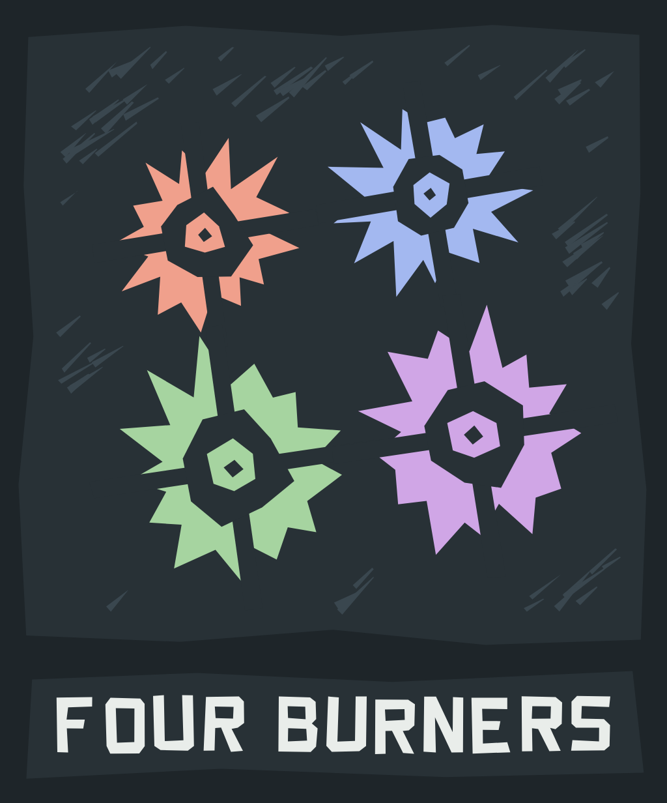

# Visual guide

Visual reference for `four-burners-android-spec.md`. Phone frames, 390 x 844 dp, rendered at 2x. The logo files are in `../brand/`.

**Where a mockup and the spec disagree, the spec is right.** Most mockups were drawn before the last round of spec changes.

## Logo

The lockup appears on the Empty screen (`chosen/01-empty.png`). The simplified icon is `../brand/four-burners-icon.svg`. See `../brand/README.md`.

## chosen/

The layouts the spec describes.

| File | Screen | Spec section |
|---|---|---|
| 01-empty.png | Empty state, with the lockup | 9.1, 11.5 |
| 02-import.png | Import, step list | 9.2 |
| 03-import-error.png | Import, error state | 9.2 |
| 04-live.png | Live, large single-instruction layout | 9.3 |
| 05-adjust-sheet.png | Adjust sheet | 9.4 |
| 06-full-schedule.png | Full schedule | 9.5 |
| 07-recipe-card.png | Recipe card, ingredients grouped by step, Grams mode | 9.7, 9.8 |
| 08-notifications.png | Timer-ended, hold-warning and ongoing notifications | 8.3, 8.4 |
| 09-done.png | Done | 9.10 |

## Known differences from the spec

- **Sample plan.** The mockups show the earlier 48-minute, 13-step plan. The spec's reference plan is 53 minutes and 18 steps, with oven preheat and water-boiling steps.
- **Not drawn at all:** the Kitchen screen (9.6), the undo bar and the third "Kitchen" button on Live (9.3), the timer sheet (10), the tools line on the Now block, the "All ingredients" section on the recipe card, the Silence button on a ringing timer, the splash screen and the launcher icon in place.
- **04-live.png** shows two bottom buttons; the spec has three. Its free-gap and interrupt states are not drawn in this layout.
- **05-adjust-sheet.png** shows timer +1 / +5 rows and an undo row. In the spec those live in the timer sheet and the undo bar; the sheet has the three switches and End session.
- **03-import-error.png** shows a "Copy error for Claude" button that is not in the spec.
- **08-notifications.png** shows "Open" as an action; in the spec, tapping the notification body opens the app and the actions are Done, Silence and +1 min.
- **09-done.png** shows per-recipe finish times, which are not in the spec.

## states-in-older-live-layout/

The free-gap state (with clock times) and the interrupt state (with a hold warning and "1 min over"), drawn in the card-stack Live layout that was not chosen. Use them for the content and wording of those states, not their layout.

## alternatives-not-chosen/

Layouts that were considered and rejected. Do not build these.

## html/

The source of each mockup as a standalone HTML file, for exact sizes, spacing and colors. They load IBM Plex Sans from the system; without it installed, headings fall back to another sans-serif.
